# Dokumen Analisis Arsitektur & Kebutuhan Backend CMS
## Panti Sosial Raharja Mandiri (PSRM)

Dokumen ini menyajikan analisis komprehensif terhadap antarmuka frontend eksisting (berbasis **Laravel 12/13**, **Inertia.js v3**, **Vue 3**, **Tailwind CSS v4**) serta merinci arsitektur backend, skema basis data, rute, dan logika bisnis yang diperlukan agar seluruh elemen tampilan publik dapat dikelola secara dinamis dan aman oleh administrator melalui CMS (*Content Management System*).

---

## 1. Ringkasan Eksekutif & Arsitektur Sistem

Saat ini, website Raharja Mandiri memiliki dua lapisan antarmuka yang telah dibangun di sisi frontend:
1. **Lapisan Publik (*Public Facing*)**: Menampilkan profil yayasan, visi-misi, sejarah linimasa, struktur pengurus, galeri kegiatan, artikel/berita, rekening donasi, daftar kebutuhan logistik, dan kontak. Seluruh data masih bersifat statis (*hardcoded* di dalam berkas `.vue`).
2. **Lapisan Admin (*Admin Panel*)**: Menampilkan dasbor dan formulir pengeditan (`resources/js/pages/admin/`). Seluruh aksi formulir saat ini baru berupa mock-up state (`ref(...)`) lokal tanpa integrasi API/Controller, serta rute login masih berupa bypass statis tanpa proteksi sesi autentikasi.

### Target Arsitektur:
- **Framework Backend**: Laravel (PHP 8.3+) dengan arsitektur MVC & Inertia Adapter.
- **Frontend Engine**: Vue 3 (Composition API / `<script setup lang="ts">`) terikat erat via Inertia.js (tanpa perlu REST API terpisah, data dialirkan sebagai *Page Props*).
- **Basis Data**: MySQL (`raharja_mandiri`).
- **File & Media Storage**: Local Public Disk (`storage/app/public` diekspos ke `public/storage` via symlink).
- **Keamanan**: Session-based Authentication dengan proteksi CSRF, Middleware `auth`, validasi ketat Form Request, dan sanitasi input HTML untuk artikel.

```mermaid
graph TD
    subgraph Publik ["Halaman Publik"]
        P1["Beranda (Hero.vue)"]
        P2["Tentang (Visi, Sejarah, Pengurus)"]
        P3["Galeri & Artikel"]
        P4["Donasi & Kontak"]
    end

    subgraph Backend ["Laravel Backend (Inertia.js)"]
        Routes["Web Routes (routes/web.php)"]
        PubCtrl["Public Controllers"]
        AdmCtrl["Admin CMS Controllers"]
        AuthMiddleware["Middleware: auth"]
        Models["Eloquent Models"]
        DB[(MySQL Database)]
        Storage["Storage Disk (Media Uploads)"]
    end

    subgraph Admin ["Admin Panel (Admin)"]
        A_Login["admin/Login.vue"]
        A_Dash["admin/Dashboard.vue (Homepage)"]
        A_Pages["admin/* (Visi, Sejarah, Artikel, dll.)"]
    end

    Publik -->|HTTP GET / Inertia Request| Routes
    Routes --> PubCtrl
    PubCtrl --> Models
    PubCtrl -->|Inertia::render(..., props)| Publik

    Admin -->|Inertia useForm Submit| Routes
    Routes --> AuthMiddleware
    AuthMiddleware --> AdmCtrl
    AdmCtrl --> Models
    AdmCtrl --> Storage
    Models --> DB
```

---

## 2. Pemetaan Komprehensif Frontend Eksisting & Kebutuhan Data

Berikut adalah audit terperinci dari setiap halaman publik, elemen UI yang ada, serta spesifikasi field backend yang dibutuhkan:

### 2.1. Beranda / Homepage (`Hero.vue` -> Rute: `/`)
Halaman ini adalah etalase utama yayasan dengan 7 seksi konten:
1. **Hero Banner**:
   - `badge_text`: Teks lencana (saat ini: *"Wujudkan Harapan Mereka"*).
   - `title_white`: Teks judul baris atas (saat ini: *"Bersama Berbagi Kasih,"*).
   - `title_gradient`: Teks judul bergradien baris bawah (saat ini: *"Membangun Masa Depan"*).
   - `description`: Deskripsi ringkas profil panti.
   - `background_image`: Gambar latar hero (`/assets/images/sepatu-1.jpg`).
   - `cta_primary_text` & `cta_primary_url`: Tombol utama donasi.
   - `cta_secondary_text` & `cta_secondary_url`: Tombol pelajari lebih lanjut.
2. **Profil Singkat ("Tentang Kami")**:
   - `about_badge`: *"Tentang Kami"*.
   - `about_title`: Judul seksi (*"Rumah Kedua yang Penuh dengan Kehangatan"*).
   - `about_image`: Foto profil yayasan (`/assets/images/tanam-3.jpg`).
   - `about_paragraph_1` & `about_paragraph_2`: Narasi singkat pengenalan.
   - `stat_children_count`: Angka anak asuh (saat ini: `120+`).
   - `stat_years_count`: Angka tahun berdiri (saat ini: `15`).
3. **Galeri Sekilas (Highlights)**:
   - 4 foto cuplikan kegiatan terbaru dari tabel galeri (atau flag `is_featured`).
4. **Program Unggulan (4 Pilar Pembinaan)**:
   - Card 1: Pendidikan (Ikon buku, deskripsi, warna biru).
   - Card 2: Kesehatan & Gizi (Ikon medis, deskripsi, warna toska).
   - Card 3: Pembinaan Karakter (Ikon akhlak/bakat, deskripsi, warna pink).
   - Card 4: Anak Asuh & Relawan (Ikon komunitas, deskripsi, warna amber).
5. **Mitra Kerja & Kolaborasi (Marquee Carousel)**:
   - Daftar partner/mitra: `name` (Pemda, Dinsos, BAZNAS, dll.), `category`, `logo_path`/`icon_type`.
6. **Kegiatan Terbaru (@psrm_raharja_mandiri)**:
   - 3 artikel/berita terbaru: Foto cover, judul, tanggal terbit, ringkasan, tautan baca.
   - Akun media sosial Instagram (`@psrm_raharja_mandiri` dan link URL).
7. **CTA Banner & WhatsApp Floating**:
   - Judul & deskripsi ajakan donasi.
   - Nomor WhatsApp tujuan & template pesan default.

---

### 2.2. Visi & Misi (`Tentang/VisiMisi.vue` -> Rute: `/tentang/visi-misi`)
1. **Hero Section**:
   - Background image, sub-judul, judul, deskripsi pembuka.
2. **Visi Besar Yayasan**:
   - Teks kutipan visi lengkap (saat ini: *"Menjadi lembaga yang mencetak generasi Mandiri, Cerdas, & Berakhlak Mulia serta memberikan dampak nyata bagi masyarakat luas."*).
3. **Daftar Misi (Langkah Nyata)**:
   - Array misi: `order_number`, `title` (misal: "Pendidikan Berkualitas"), `description`, `color_theme`.

---

### 2.3. Sejarah Linimasa (`Tentang/Sejarah.vue` -> Rute: `/tentang/sejarah`)
1. **Hero Section**:
   - Background image, judul (*"Jejak Langkah Raharja Mandiri"*), deskripsi.
2. **Daftar Milestones (Timeline Peristiwa)**:
   - `year`: Tahun atau penanda periode (misal: "2009", "2015", "2020", "Sekarang").
   - `title`: Judul momentum (misal: "Awal Mula Pendirian", "Langkah Pertama Ekspansi").
   - `description`: Uraian narasi sejarah peristiwa tersebut.
   - `image_path`: Foto dokumentasi peristiwa terkait.
   - `order`: Urutan linimasa agar dapat disusun kronologis.

---

### 2.4. Susunan Kepengurusan (`Tentang/Kepengurusan.vue` -> Rute: `/tentang/kepengurusan`)
1. **Hero Section**:
   - Background image, judul (*"Susunan Pengurus"*), deskripsi.
2. **Daftar Pengurus Yayasan**:
   - `name`: Nama lengkap beserta gelar (misal: *H. Ahmad Sudirman, M.Ag*).
   - `role`: Jabatan (Ketua Yayasan, Sekretaris, Bendahara, Kepala Pengasuh, Divisi Kesehatan, Humas & Kemitraan).
   - `photo_path`: Foto formal pengurus.
   - `order`: Hirarki susunan organisasi untuk penentuan posisi tampilan grid.

---

### 2.5. Galeri Momen Kegiatan (`Galeri.vue` -> Rute: `/galeri`)
1. **Kategori Galeri**:
   - Tab filter: "Semua Momen", "Pendidikan", "Kesehatan", "Keagamaan", "Kunjungan", dll.
2. **Koleksi Foto Galeri**:
   - `title`: Judul kegiatan foto.
   - `category`: Kategori foto.
   - `image_path`: Lokasi berkas gambar resolusi tinggi.
   - `aspect_ratio`/`height_class`: Pengaturan dimensi atau otomatis via masonry.
   - `activity_date`: Tanggal dokumentasi.

---

### 2.6. Berita & Artikel Jurnal (`Artikel.vue` & `BacaArtikel.vue`)
*Catatan Penting*: Saat ini halaman artikel menggunakan query parameter panjang pada URL (`/artikel/baca?img=...&title=...`). Untuk standar CMS profesional, rute ini harus diubah menjadi berbasis **Slug** (`/artikel/{slug}`).
1. **Indeks Artikel (`Artikel.vue`)**:
   - `featured_article`: 1 artikel utama yang disematkan (*pinned*) dengan layout besar horizontal.
   - `articles_list`: Daftar artikel terbitan terbaru dengan paginasi.
   - Filter berdasarkan kategori & pencarian kata kunci.
2. **Halaman Baca Artikel (`BacaArtikel.vue`)**:
   - `title`: Judul lengkap artikel.
   - `slug`: URL ramah SEO (misal: `bantuan-pendidikan-semester-ganjil-2026`).
   - `category`: Kategori artikel.
   - `published_at`: Tanggal publikasi terformat (misal: *10 Okt 2026*).
   - `cover_image`: Foto utama artikel.
   - `summary`: Ringkasan pembuka.
   - `content`: Konten artikel (paragraf narasi kaya teks, paragraf lanjutan).
   - `quote` & `quote_author`: Kutipan inspiratif & narasumbernya.
   - `gallery_images`: Foto-foto pendukung kegiatan dalam artikel (array JSON/relasi).
   - `views_count`: Jumlah pembaca artikel.
   - `recommended_articles`: 2 artikel terkait lainnya yang direkomendasikan otomatis.

---

### 2.7. Donasi Rekening (`Donasi/Rekening.vue` -> Rute: `/donasi/rekening`)
1. **Daftar Rekening Bank & E-Wallet**:
   - `bank_name`: Nama Bank (Bank Syariah Indonesia, Bank Mandiri, Bank Central Asia, dll.).
   - `account_number`: Nomor rekening (misal: `712 345 6789`).
   - `account_holder`: Atas nama rekening (misal: *Yayasan Raharja Mandiri*).
   - `logo_path`: Logo bank/e-wallet.
   - `theme_color`: Warna aksen kartu bank (teal, blue, dark-blue, dll.).
   - `is_active`: Status aktif/tampil.
   - `order`: Urutan tampilan prioritas.
2. **Konfirmasi Donasi**:
   - Tautan WhatsApp konfirmasi (`wa.me/...`) dan teks template.

---

### 2.8. Donasi Daftar Kebutuhan (`Donasi/Kebutuhan.vue` -> Rute: `/donasi/kebutuhan`)
1. **Daftar Kebutuhan Barang/Fisik**:
   - `name`: Nama kebutuhan (misal: *Sembako Utama*, *Pakaian Sekolah*, *Alat Tulis*).
   - `description`: Rincian spesifik barang (misal: *Beras, Minyak Goreng, Gula, dan Susu*).
   - `quantity_target`: Jumlah yang dibutuhkan (misal: *50 Paket*, *30 Set*, *Bebas*).
   - `urgency_status`: Status urgensi (*Mendesak*, *Rutin*, *Terpenuhi*).
   - `color_theme`: Warna kartu status (pink, amber, blue, teal).
   - `is_active`: Status aktifitas kebutuhan.

---

### 2.9. Informasi Kontak & Formulir Pesan (`Kontak.vue` -> Rute: `/kontak`)
1. **Informasi Kontak**:
   - `full_address`: Alamat fisik panti (Tanjungsari, Sumedang).
   - `phone_number`: Nomor telepon / WhatsApp kantor.
   - `email`: Alamat email resmi yayasan.
   - `operational_hours`: Jam kerja layanan operasional.
   - `instagram_username` & `instagram_url`.
   - `google_maps_url`: Tautan lokasi Google Maps.
2. **Formulir Interaktif Publik ("Kirimkan Pesan")**:
   - Field input: Nama Lengkap (`sender_name`), Email/Telepon (`sender_contact`), Isi Pesan (`message`).
   - Harus disimpan ke dalam basis data admin CMS (`contact_messages`), bukan sekadar `@submit.prevent` statis.

---

### 2.10. Komponen Global (Navbar & Footer)
1. **Navbar (`Navbar.vue`)**:
   - Nama institusi, logo, struktur navigasi menu dropdown.
2. **Footer (`Footer.vue`)**:
   - Deskripsi profil ringkas yayasan.
   - Legalitas resmi yayasan:
     - *Akta Pendirian*: `C-1051.HT.01.02.TH 2004`.
     - *Tanda Daftar Yayasan*: `02/27.1BY.1/31.74/2019`.
   - Logo mitra pendukung (*Supported by*: `logo_iCraft.png`).
   - Teks hak cipta tahunan.

---

## 3. Audit Kesenjangan Admin CMS (*Gap Analysis*)

Berdasarkan pengecekan berkas pada `resources/js/pages/admin/`, berikut adalah kesenjangan yang ditemukan antara frontend admin saat ini dengan kebutuhan nyata:

| Modul Konten | Status Admin Saat Ini | Hal yang Kurang / Perlu Ditambahkan |
| :--- | :--- | :--- |
| **Autentikasi (`Login.vue`)** | Hanya template HTML dengan tombol redirect statis ke `/admin/dashboard` | Butuh form submission ke `POST /admin/login`, validasi kredensial Laravel Auth, proteksi sesi, rate-limiting, dan middleware `auth`. |
| **Homepage / Hero (`Dashboard.vue`)** | Hanya menyediakan form edit 3 field: `titleTop`, `titleBottom`, `description` | Kurang edit `background_image`, `badge`, tombol CTA, edit seksi **Profil Singkat & Counter Angka**, edit **Mitra Marquee**, dan edit **Program Unggulan**. |
| **Sejarah (`admin/Sejarah.vue`)** | Form edit linimasa: tahun, judul, deskripsi | Kurang input **Upload Foto Dokumentasi** untuk tiap momentum sejarah dan reordering urutan. |
| **Visi & Misi (`admin/VisiMisi.vue`)** | Form edit visi dan array misi | Perlu penyesuaian endpoint PUT/POST untuk menyimpan seluruh daftar misi ke database. |
| **Kepengurusan (`admin/Kepengurusan.vue`)** | Form tambah & daftar pengurus (nama, jabatan) | Input foto masih berupa mock SVG border dashed tanpa fungsi file-picker nyata, butuh endpoint simpan & hapus. |
| **Galeri (`admin/Galeri.vue`)** | Form upload foto (judul, kategori, box upload) dan list foto | Butuh integrasi file upload multi-part FormData, validasi file, dan tombol delete/edit fungsional. |
| **Artikel & Berita (`admin/Artikel.vue` & `DetailArtikel.vue`)** | Tabel list artikel dan form editor artikel | Kurang otomatisasi **Slug**, penanganan status *Draft* vs *Published*, upload cover, serta penambahan quote & secondary photos. |
| **Rekening Donasi (`admin/Rekening.vue`)** | Form daftar rekening bank (nama bank, no rek, pemilik) | Upload logo bank masih mock, butuh fungsi hapus dan tambah bank baru. |
| **Kontak (`admin/Kontak.vue`)** | Form edit data kontak (alamat, telepon, email, maps, IG) | Belum ada controller penerima data untuk menyimpan ke tabel settings. |
| **Daftar Kebutuhan (`/donasi/kebutuhan`)** | **BELUM ADA DI ADMIN** | Perlu dibuat halaman `admin/Kebutuhan.vue` untuk mengelola barang yang dibutuhkan anak panti (CRUD). |
| **Pesan Masuk (`Inbox / Pesan`)** | **BELUM ADA DI ADMIN** | Perlu dibuat halaman `admin/Pesan.vue` untuk membaca dan mengelola pesan yang dikirim pengunjung lewat form Kontak. |
| **Pengaturan Global (Site Settings)** | Tersebar terpisah-pisah | Perlu satu konsolidasi pengaturan: Legalitas footer (Akta & Izin), nomor WhatsApp tombol melayang, logo yayasan. |

---

## 4. Desain Skema Basis Data (Database Schema & Migrations)

Berikut adalah perancangan tabel-tabel MySQL untuk menampung seluruh data website:

```mermaid
erDiagram
    USERS ||--o{ ARTICLES : "writes"
    ARTICLE_CATEGORIES ||--o{ ARTICLES : "classifies"
    GALLERY_CATEGORIES ||--o{ GALLERIES : "categorizes"

    USERS {
        bigint id PK
        string name
        string email
        string password
        string role
        timestamps created_at
    }

    SITE_SETTINGS {
        bigint id PK
        string key UK
        text value
        string type
        string group
        timestamps updated_at
    }

    PROGRAMS {
        bigint id PK
        string title
        text description
        string icon_name
        string color_theme
        int sort_order
        boolean is_active
    }

    PARTNERS {
        bigint id PK
        string name
        string category
        string icon_type
        string logo_path
        int sort_order
        boolean is_active
    }

    HISTORIES {
        bigint id PK
        string year
        string title
        text description
        string image_path
        int sort_order
    }

    MISSIONS {
        bigint id PK
        string title
        text description
        string color_theme
        int sort_order
    }

    TEAMS {
        bigint id PK
        string name
        string role
        string photo_path
        int sort_order
        boolean is_active
    }

    GALLERY_CATEGORIES {
        bigint id PK
        string name
        string slug UK
    }

    GALLERIES {
        bigint id PK
        bigint category_id FK
        string title
        string image_path
        string aspect_height
        date activity_date
        int sort_order
    }

    ARTICLE_CATEGORIES {
        bigint id PK
        string name
        string slug UK
    }

    ARTICLES {
        bigint id PK
        bigint user_id FK
        bigint category_id FK
        string title
        string slug UK
        text summary
        longtext content
        string cover_image
        text quote
        string quote_author
        json additional_images
        enum status "draft,published"
        bigint views_count
        timestamp published_at
    }

    BANK_ACCOUNTS {
        bigint id PK
        string bank_name
        string account_number
        string account_holder
        string logo_path
        string color_theme
        int sort_order
        boolean is_active
    }

    DONATION_NEEDS {
        bigint id PK
        string item_name
        text description
        string quantity_target
        enum urgency "Mendesak,Rutin,Terpenuhi"
        string color_theme
        int sort_order
        boolean is_active
    }

    CONTACT_MESSAGES {
        bigint id PK
        string name
        string contact
        text message
        boolean is_read
        timestamps created_at
    }
```



### Rincian Tabel:
1. **`users`**: Akun login administrator (id, name, email, password, role).
2. **`site_settings`**: Menyimpan konfigurasi key-value berulang tanpa perlu membuat banyak tabel kecil:
   - *Group Hero*: `hero_badge`, `hero_title_top`, `hero_title_bottom`, `hero_desc`, `hero_bg_image`, `hero_cta_primary_url`, dll.
   - *Group About*: `about_title`, `about_desc_1`, `about_desc_2`, `about_image`, `stat_children`, `stat_years`.
   - *Group Visi*: `vision_quote_text`.
   - *Group Contact*: `contact_address`, `contact_phone`, `contact_email`, `contact_instagram`, `contact_maps_url`, `whatsapp_floating_number`, `whatsapp_default_message`.
   - *Group Legal*: `legal_akta`, `legal_izin`, `copyright_text`.
3. **`programs`**: Program unggulan di homepage (Pendidikan, Kesehatan, Karakter, Relawan).
4. **`partners`**: Mitra kerja pada carousel marquee.
5. **`histories`**: Linimasa peristiwa sejarah (tahun, judul, deskripsi, foto, urutan).
6. **`missions`**: Daftar 4+ pilar misi yayasan.
7. **`teams`**: Susunan pengurus panti (nama, gelar, jabatan, foto, urutan).
8. **`galleries` & `gallery_categories`**: Koleksi foto kegiatan dengan kategorisasi.
9. **`articles` & `article_categories`**: Berita dan kegiatan yayasan, lengkap dengan slug, thumbnail, rich content, dan quote inspiratif.
10. **`bank_accounts`**: Rekening donasi resmi.
11. **`donation_needs`**: Daftar kebutuhan barang fisik/mendesak.
12. **`contact_messages`**: Kotak masuk pesan dari form kontak publik.

---

## 5. Spesifikasi Routing & Endpoints (Laravel Web Routes)

### 5.1. Rute Publik (`Public Routes`)
Semua rute publik akan menggunakan Controller untuk mengambil data dari basis data dan mengalirkannya ke halaman Vue via `Inertia::render(...)`:

```php
// routes/web.php (Publik)
use App\Http\Controllers\Public\HomeController;
use App\Http\Controllers\Public\AboutController;
use App\Http\Controllers\Public\GalleryController;
use App\Http\Controllers\Public\ArticleController;
use App\Http\Controllers\Public\DonationController;
use App\Http\Controllers\Public\ContactController;

Route::get('/', [HomeController::class, 'index'])->name('home');

Route::prefix('tentang')->name('tentang.')->group(function () {
    Route::get('/visi-misi', [AboutController::class, 'visionMission'])->name('visi-misi');
    Route::get('/sejarah', [AboutController::class, 'history'])->name('sejarah');
    Route::get('/kepengurusan', [AboutController::class, 'organization'])->name('kepengurusan');
});

Route::get('/galeri', [GalleryController::class, 'index'])->name('galeri');

Route::prefix('artikel')->name('artikel.')->group(function () {
    Route::get('/', [ArticleController::class, 'index'])->name('index');
    Route::get('/{slug}', [ArticleController::class, 'show'])->name('show'); // Menggantikan query string /artikel/baca?title=...
});

Route::prefix('donasi')->name('donasi.')->group(function () {
    Route::get('/rekening', [DonationController::class, 'accounts'])->name('rekening');
    Route::get('/kebutuhan', [DonationController::class, 'needs'])->name('kebutuhan');
});

Route::get('/kontak', [ContactController::class, 'index'])->name('kontak');
Route::post('/kontak', [ContactController::class, 'store'])->name('kontak.store'); // Form submission publik
```

---

### 5.2. Rute Autentikasi Admin (`Auth Routes`)
```php
use App\Http\Controllers\Admin\AuthController;

Route::prefix('admin')->name('admin.')->group(function () {
    Route::middleware('guest')->group(function () {
        Route::get('/login', [AuthController::class, 'showLoginForm'])->name('login');
        Route::post('/login', [AuthController::class, 'login'])->name('login.post');
    });

    Route::post('/logout', [AuthController::class, 'logout'])->middleware('auth')->name('logout');
});
```

---

### 5.3. Rute CMS Admin Terproteksi (`Admin CMS Routes`)
Semua rute di bawah ini diproteksi oleh middleware `auth`:

```php
use App\Http\Controllers\Admin\DashboardController;
use App\Http\Controllers\Admin\HistoryController;
use App\Http\Controllers\Admin\VisionMissionController;
use App\Http\Controllers\Admin\TeamController;
use App\Http\Controllers\Admin\GalleryAdminController;
use App\Http\Controllers\Admin\ArticleAdminController;
use App\Http\Controllers\Admin\BankAccountController;
use App\Http\Controllers\Admin\DonationNeedController;
use App\Http\Controllers\Admin\ContactAdminController;
use App\Http\Controllers\Admin\MessageAdminController;

Route::prefix('admin')->name('admin.')->middleware('auth')->group(function () {
    // Dashboard & Homepage (Hero, About, Counter)
    Route::get('/dashboard', [DashboardController::class, 'index'])->name('dashboard');
    Route::post('/dashboard/hero', [DashboardController::class, 'updateHero'])->name('dashboard.hero');
    Route::post('/dashboard/about', [DashboardController::class, 'updateAbout'])->name('dashboard.about');

    // Sejarah (CRUD Linimasa)
    Route::get('/sejarah', [HistoryController::class, 'index'])->name('sejarah');
    Route::post('/sejarah', [HistoryController::class, 'store'])->name('sejarah.store');
    Route::post('/sejarah/{id}', [HistoryController::class, 'update'])->name('sejarah.update');
    Route::delete('/sejarah/{id}', [HistoryController::class, 'destroy'])->name('sejarah.destroy');

    // Visi & Misi
    Route::get('/visi-misi', [VisionMissionController::class, 'index'])->name('visi-misi');
    Route::post('/visi-misi', [VisionMissionController::class, 'update'])->name('visi-misi.update');

    // Kepengurusan
    Route::get('/kepengurusan', [TeamController::class, 'index'])->name('kepengurusan');
    Route::post('/kepengurusan', [TeamController::class, 'store'])->name('kepengurusan.store');
    Route::post('/kepengurusan/{id}', [TeamController::class, 'update'])->name('kepengurusan.update');
    Route::delete('/kepengurusan/{id}', [TeamController::class, 'destroy'])->name('kepengurusan.destroy');

    // Galeri
    Route::get('/galeri', [GalleryAdminController::class, 'index'])->name('galeri');
    Route::post('/galeri', [GalleryAdminController::class, 'store'])->name('galeri.store');
    Route::delete('/galeri/{id}', [GalleryAdminController::class, 'destroy'])->name('galeri.destroy');

    // Artikel & Berita
    Route::get('/artikel', [ArticleAdminController::class, 'index'])->name('artikel');
    Route::get('/artikel/create', [ArticleAdminController::class, 'create'])->name('artikel.create');
    Route::post('/artikel', [ArticleAdminController::class, 'store'])->name('artikel.store');
    Route::get('/artikel/{id}/edit', [ArticleAdminController::class, 'edit'])->name('artikel.edit');
    Route::post('/artikel/{id}', [ArticleAdminController::class, 'update'])->name('artikel.update');
    Route::delete('/artikel/{id}', [ArticleAdminController::class, 'destroy'])->name('artikel.destroy');

    // Rekening Donasi
    Route::get('/rekening', [BankAccountController::class, 'index'])->name('rekening');
    Route::post('/rekening', [BankAccountController::class, 'store'])->name('rekening.store');
    Route::post('/rekening/{id}', [BankAccountController::class, 'update'])->name('rekening.update');
    Route::delete('/rekening/{id}', [BankAccountController::class, 'destroy'])->name('rekening.destroy');

    // Daftar Kebutuhan (Modul Baru yang Perlu Ditambahkan)
    Route::get('/kebutuhan', [DonationNeedController::class, 'index'])->name('kebutuhan');
    Route::post('/kebutuhan', [DonationNeedController::class, 'store'])->name('kebutuhan.store');
    Route::post('/kebutuhan/{id}', [DonationNeedController::class, 'update'])->name('kebutuhan.update');
    Route::delete('/kebutuhan/{id}', [DonationNeedController::class, 'destroy'])->name('kebutuhan.destroy');

    // Informasi Kontak & Pengaturan Global
    Route::get('/kontak', [ContactAdminController::class, 'index'])->name('kontak');
    Route::post('/kontak', [ContactAdminController::class, 'update'])->name('kontak.update');

    // Kotak Masuk Pesan Publik
    Route::get('/pesan', [MessageAdminController::class, 'index'])->name('pesan');
    Route::patch('/pesan/{id}/read', [MessageAdminController::class, 'markAsRead'])->name('pesan.read');
    Route::delete('/pesan/{id}', [MessageAdminController::class, 'destroy'])->name('pesan.destroy');
});
```

---

## 6. Logika Bisnis & Struktur Model (Architecture Logic)

### 6.1. Pengelolaan Media & Berkas (*File Storage Architecture*)
- Seluruh berkas yang diunggah (foto sampul artikel, foto dokumentasi sejarah, foto pengurus, gambar galeri, dan logo rekening) akan disimpan di `storage/app/public/{folder_name}`.
- Gunakan symlink standar Laravel: `php artisan storage:link`.
- Trait/Helper `UploadHelper` dapat dibuat untuk menangani:
  - Validasi mimetype (`image/jpeg,image/png,image/webp`).
  - Maksimal ukuran (misal 2MB).
  - Penamaan unik berbasis slug/timestamp/hash acak (`Str::random(20)`).
  - Pembersihan (*unlink*) berkas lama saat gambar diganti atau data dihapus.

### 6.2. Pola Penanganan Nilai Pengaturan Global (*Site Setting Pattern*)
Agar enteng dan tidak membutuhkan query berulang:
- Buat Helper `Setting::get('key', 'default_value')` dan `Setting::set('key', 'value')`.
- Untuk komponen global (seperti nomor WhatsApp, alamat di Footer, legalitas yayasan), buat middleware Inertia `HandleInertiaRequests` untuk membagikan (*share*) data pengaturan secara global ke seluruh halaman Vue (`$page.props.settings`).

### 6.3. Otomatisasi Slug & Paginasi Artikel
- Pembuatan slug otomatis dari judul: `Str::slug($request->title)`. Jika terjadi duplikasi judul, tambahkan suffix waktu atau id (`judul-artikel-123`).
- Paginasi: gunakan `Article::where('status', 'published')->latest('published_at')->paginate(9)` sehingga frontend dapat menampilkan navigasi halaman secara otomatis.

---

## 7. Rencana Integrasi Frontend (Inertia Props & Form Handling)

### 7.1. Di Sisi Halaman Publik:
Setiap komponen Vue publik yang saat ini memiliki array statis akan diubah menjadi menerima `props`:
```vue
<script setup lang="ts">
import { Head, Link } from '@inertiajs/vue3';

// Menerima data dinamis dari Controller via props
const props = defineProps<{
    hero?: {
        titleTop: string;
        titleBottom: string;
        description: string;
        bgImage: string;
    };
    latestNews: Array<{
        id: number;
        title: string;
        date: string;
        summary: string;
        image: string;
        slug: string;
    }>;
    partners: Array<{
        name: string;
        category: string;
        type: string;
    }>;
}>();
</script>
```

### 7.2. Di Sisi Halaman Admin:
Setiap formulir di halaman admin akan memanfaatkan `useForm` dari `@inertiajs/vue3`:
```vue
<script setup lang="ts">
import { useForm } from '@inertiajs/vue3';

const props = defineProps<{
    heroData: {
        titleTop: string;
        titleBottom: string;
        description: string;
    };
}>();

const form = useForm({
    titleTop: props.heroData.titleTop,
    titleBottom: props.heroData.titleBottom,
    description: props.heroData.description,
    bgImage: null as File | null,
});

const submit = () => {
    form.post('/admin/dashboard/hero', {
        preserveScroll: true,
        onSuccess: () => alert('Berhasil memperbarui hero section!'),
    });
};
</script>
```

---

## 8. Roadmap Tahapan Implementasi (Step-by-Step Plan)

Rekomendasi urutan pengerjaan backend yang logis, modular, dan minim risiko regresi:

### Tahap 1: Persiapan Dasar, Basis Data & Media Link
1. Jalankan `php artisan storage:link`.
2. Buat migration untuk semua tabel:
   - `create_site_settings_table`
   - `create_histories_table`
   - `create_missions_table`
   - `create_teams_table`
   - `create_gallery_categories_and_galleries_table`
   - `create_article_categories_and_articles_table`
   - `create_bank_accounts_table`
   - `create_donation_needs_table`
   - `create_contact_messages_table`
   - `create_programs_and_partners_table`
3. Buat database Seeder (`DatabaseSeeder.php`) yang menyuntikkan data eksisting (dummy saat ini) ke dalam database agar tampilan publik tidak kosong saat pertama kali diintegrasikan.

### Tahap 2: Sistem Autentikasi Admin
1. Buat `AuthController` untuk menangani form login, verifikasi hash bcrypt password, regenerasi session, dan logout.
2. Buat akun superadmin pertama via Seeder (`admin@raharjamandiri.org`).
3. Pasang middleware `auth` pada grup rute `/admin/*`.

### Tahap 3: Implementasi Controller Admin CMS & Modul Baru
1. Buat Controller CRUD untuk masing-masing modul admin (`DashboardController`, `HistoryController`, `VisionMissionController`, `TeamController`, `GalleryAdminController`, `ArticleAdminController`, `BankAccountController`, `ContactAdminController`).
2. Buat 2 modul baru yang belum ada di admin:
   - `resources/js/pages/admin/Kebutuhan.vue` (Kelola kebutuhan barang donasi).
   - `resources/js/pages/admin/Pesan.vue` (Melihat pesan inbox dari pengunjung).
3. Sambungkan formulir di halaman admin dengan `useForm` Inertia ke endpoint backend yang sesuai.

### Tahap 4: Integrasi Controller Publik & Injeksi Props
1. Buat `HomeController`, `AboutController`, `GalleryController`, `ArticleController`, `DonationController`, `ContactController`.
2. Ubah `routes/web.php` dari `Route::inertia(...)` menjadi memanggil controller publik.
3. Hubungkan form pengiriman pesan di `resources/js/pages/Kontak.vue` agar mengirim data ke `POST /kontak`.
4. Sesuaikan `BacaArtikel.vue` agar membaca data artikel berdasarkan parameter `slug` alih-alih query string.

### Tahap 5: Pengujian Akhir & Validasi
1. Uji alur login & proteksi rute (mencoba buka `/admin/dashboard` tanpa login harus di-redirect ke `/admin/login`).
2. Uji upload media (pastikan file tersimpan di storage dan URL foto tampil baik di halaman publik).
3. Uji pengubahan teks di CMS (misal ubah teks hero, cek apakah halaman beranda langsung berubah).
4. Uji formulir kontak dan pastikan pesan masuk ke halaman pesan admin.

---

## 9. Kesimpulan

Dengan menerapkan arsitektur di atas:
- **Admin Yayasan** memiliki kontrol 100% terhadap seluruh teks, foto, program, kegiatan, artikel, nomor rekening, dan barang kebutuhan yang tampil di publik secara instan tanpa perlu menyentuh kode program.
- **Pengunjung** mendapatkan pengalaman website yang cepat, interaktif, dan modern berkat perpaduan performa Laravel dan reaktivitas Vue 3 melalui Inertia.js.
- **Pengembang** memiliki struktur kode yang bersih, terdokumentasi rapi, terisolasi dengan baik antar modul, serta mudah dirawat atau dikembangkan di masa mendatang.
